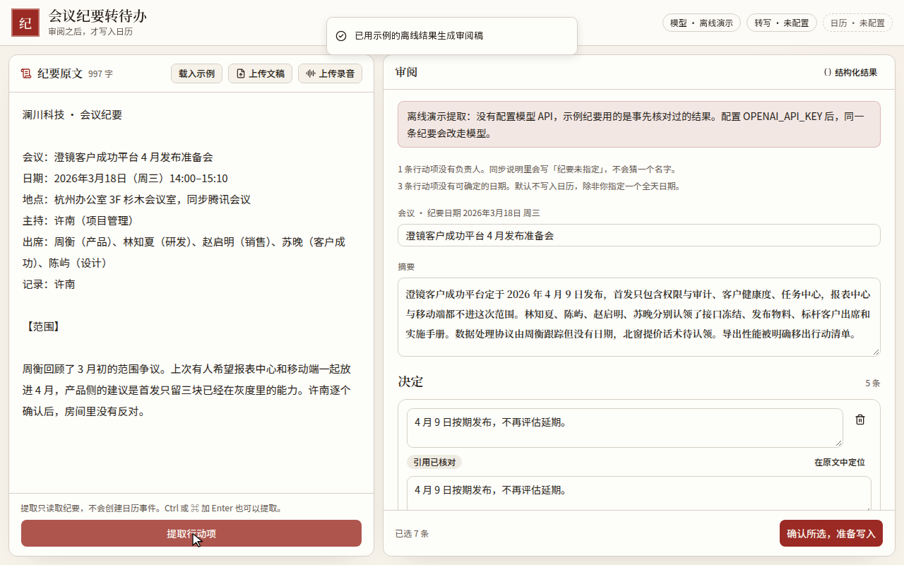
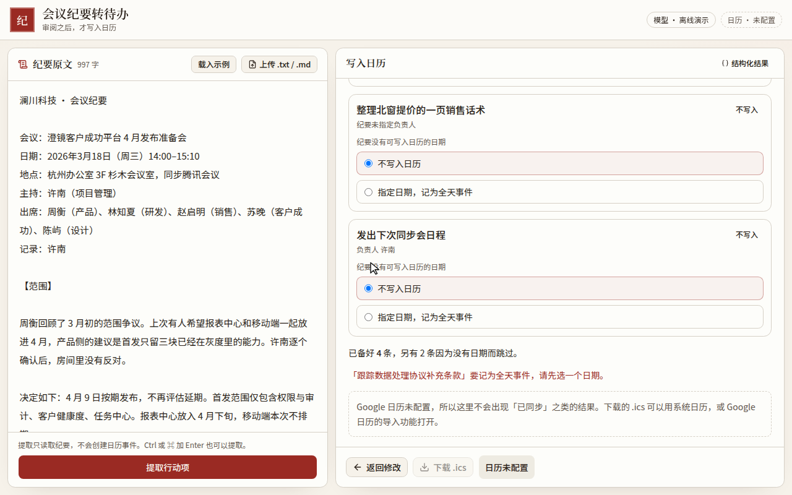
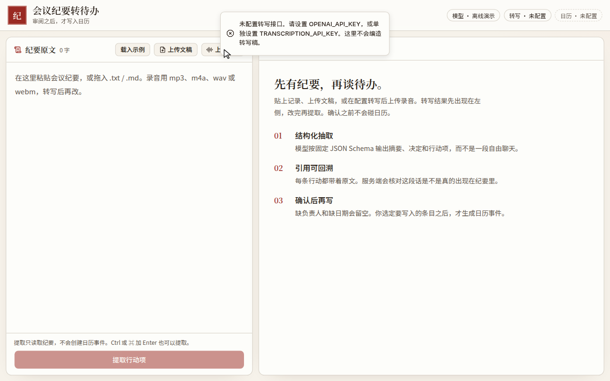
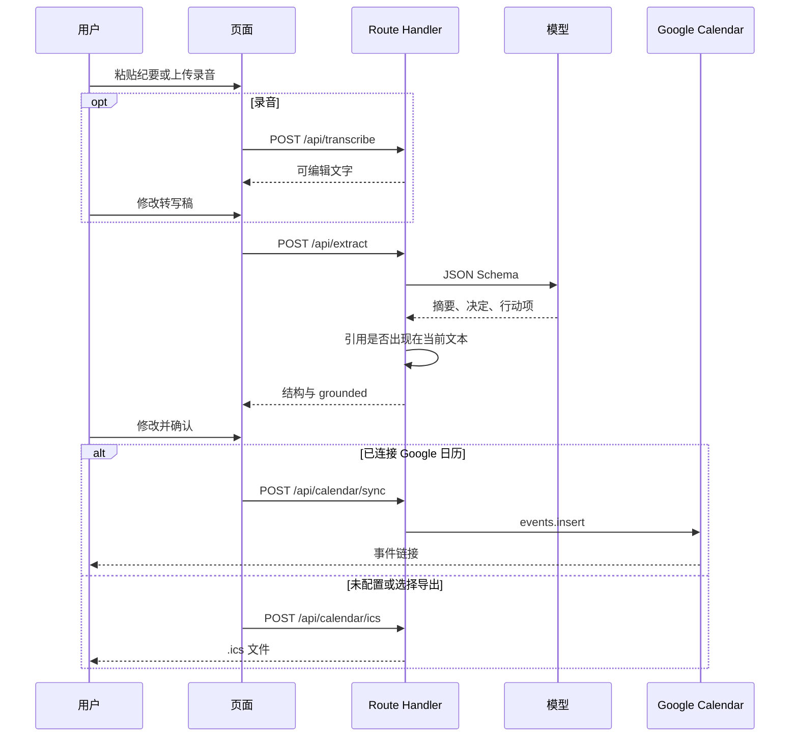

# 会议纪要转待办

English: Paste meeting notes, or upload a recording, and turn them into action items with source quotes. Nothing is written to a calendar until a person confirms it. Without model or transcription credentials the app says so, and it does not invent a transcript or a Google event.

把一场会的纪要或录音，变成带来源引用、经人确认后才写入日历的行动项。

## 线上演示

<https://meeting-to-actions-sigma.vercel.app>

备用地址：<https://meeting-to-actions-sajiaji310.vercel.app>

## 问题

会议纪要里，已经拍板的决定、某人认领的任务，和「如果来得及可以看一眼」混在一起。直接丢给聊天框，模型容易补上纪要里没有的负责人和日期，也容易在人还没看过的时候改掉日历。

这个应用把抽取、核对、确认和写入拆开。模型只负责按固定结构读纪要。人可以改每一条。日历只在确认之后才会被碰到。

## 演示

下面三张图来自本地运行，没有接入模型密钥和 Google 账号。示例纪要是内置的，离线结果也是事先核对过的，页面上写明了这一点。

审阅稿：摘要、决定，以及还没填日期的行动项。



写入前的门槛：没有日期的条目默认不进日历；全天日期没填完时，`.ics` 保持禁用。Google 未配置时，页面说明不会出现「已同步」。



上传录音但没有转写密钥时，编辑区保持空白。



仓库里没有示例音频。合成一段语音再当作会议录音，和编造转写稿是同一类问题。

## 功能

- 粘贴纪要，或上传 `.txt` / `.md`。
- 上传 mp3、m4a、wav、webm（也接受常见的 mp4、ogg、flac）。转写结果先进入可编辑文本框。
- 抽出会议摘要、决定和行动项。行动项包含标题、负责人、日期、钟点，以及一段原文。
- 负责人或日期在纪要里没写，就留空。「尽快」不会被换成今天。
- 审阅时可以改、增、删、取消勾选。点「在原文中定位」会标出对应句子。
- 确认之后才导出 `.ics`，或在已完成 Google OAuth 时写入主日历。
- 没有日期的条目默认跳过，也可以由人指定一个全天日期。

## 架构



页面是一个工作台，不是多轮对话。会话只放在加密 cookie 里，没有本地数据库，也没有常驻进程。示例纪要写在源码里，部署时不读磁盘上的数据文件。

## 它在演示的做法

- **严格 JSON 抽取。** 对话补全使用封闭的 JSON Schema（`additionalProperties: false`，缺的字段是 `null`）。结构不对会换一种 `response_format` 再试，而不是把一段散文直接交给用户。
- **引用要能在原文里找到。** 每条决定和行动项都带连续原文。服务端用当前文本框里的文字做核对，对不上就标出来。转写稿被改过之后，核对的是改过的文字，不是模型第一次返回的那一版。
- **缺了就不编。** 没点名的负责人是空的。日期只有原文给出公历，或能凭纪要里的会议日期唯一换算时才填写。
- **先审阅，再写入。** 提取和转写都不会创建日历事件。服务端拒绝 `confirmed !== true` 的写入。
- **不假装同步。** 没有 Google OAuth 时，按钮不会报成功。`.ics` 是本地文件，页面也这样说。
- **转写是可编辑的文本，不是直接抽取。** 没有转写密钥时返回说明，不生成假稿。

## 技术栈

Next.js（App Router）、TypeScript、Tailwind CSS、shadcn/ui。模型调用走 OpenAI 兼容的 Chat Completions 和 `/audio/transcriptions`。日历是 Google OAuth 2.0 授权码，范围只有 `calendar.events`，令牌用 AES-GCM 封进 httpOnly cookie。

## 本地运行

需要 Node.js 22 或更新版本。

```bash
cp .env.example .env.local
npm install
npm run dev
```

开发服务器在 [http://127.0.0.1:3847](http://127.0.0.1:3847)。这个端口只用于本地 `npm run dev`，部署时不写死。

点「载入示例」，再点「提取行动项」。未配置 `OPENAI_API_KEY` 时，只有这份内置纪要能抽出结果，页面会标明是离线演示。示例是澜川科技「澄镜」2026-03-18 的发布准备会：林知夏 3 月 20 日、陈屿 3 月 25 日、赵启明 3 月 27 日、苏晚 3 月 31 日；周衡的「尽快」和未认领的北窗话术留空。

```bash
npm test
npm run lint
npm run build
npm start
```

`npm start` 读取 `PORT`，不绑定 3847。

## 部署到 Vercel

从这份 Origin 仓库部署，不要再镜像到 GitHub。Vercel 项目使用仓库根目录，框架选 Next.js，安装和构建保持默认（`npm install`、`next build`）。生产分支用 `main`。本仓库没有 `vercel.json` 去改这些命令。

应用按无状态函数来写：不读本地数据文件，不依赖常驻进程。OAuth 回跳用请求上的 `x-forwarded-proto` / `x-forwarded-host`；在 Vercel 上如果协议头缺失，则按 https 处理。生产环境的会话 cookie 带 `Secure`。更稳妥的做法是在 Production 环境显式设置 `APP_BASE_URL` 和 `GOOGLE_REDIRECT_URI`，两者使用同一个 https 域名。

### 环境变量

在 Vercel 项目的 Environment Variables 里设置。密钥不要提交进仓库。

| 变量 | 何时需要 | 填什么 |
| --- | --- | --- |
| `OPENAI_API_KEY` | 真实抽取，以及未单独配置转写时的转写 | 兼容接口的密钥。留空则只有内置示例能抽取。 |
| `OPENAI_BASE_URL` | 可选 | 默认 `https://api.openai.com/v1`。 |
| `OPENAI_MODEL` | 可选 | 默认 `gpt-4o-mini`。 |
| `TRANSCRIPTION_API_KEY` | 可选 | 留空则转写复用 `OPENAI_API_KEY`。 |
| `TRANSCRIPTION_BASE_URL` | 可选 | 留空则转写复用 `OPENAI_BASE_URL`。 |
| `TRANSCRIPTION_MODEL` | 可选 | 默认 `gpt-4o-mini-transcribe`。Whisper 服务改成该平台的模型名。 |
| `TRANSCRIPTION_LANGUAGE` | 可选 | 默认 `zh`。 |
| `GOOGLE_CLIENT_ID` | 要写入 Google 日历时 | OAuth 客户端 ID。Web 应用。 |
| `GOOGLE_CLIENT_SECRET` | 同上 | OAuth 客户端密钥。 |
| `GOOGLE_REDIRECT_URI` | 同上 | `https://<你的域名>/api/auth/google/callback`。必须和 Google Cloud 里登记的重定向 URI 逐字相同，包括 https。 |
| `SESSION_SECRET` | 使用 Google 登录时 | 随机长字符串，用来加密 cookie。`node -e "console.log(require('crypto').randomBytes(32).toString('hex'))"` |
| `APP_BASE_URL` | 建议在 Production 设置 | `https://<你的域名>`，不要结尾斜线。OAuth 完成后回到这个来源。 |
| `AUDIO_MAX_BYTES` | 可选 | 不设即可。Vercel 上自动按 4MB 拒绝录音。 |

Google Cloud 里启用 Calendar API。同意屏幕处于测试状态时，把要登录的 Google 账号加为测试用户。范围是 `openid`、`email` 和 `https://www.googleapis.com/auth/calendar.events`。

预览部署的域名和正式域名不同。`GOOGLE_REDIRECT_URI` 通常只登记正式域名，所以日历登录以 Production 环境为准。预览环境不填这两项时，抽取和 `.ics` 仍然可用。

### 录音大小

Vercel Serverless 的请求体上限是 **4.5MB**（含 multipart 边框）。应用在检测到 `VERCEL=1` 时把录音卡在 **4MB**，超过就用中文说明原因，不把一个会被平台截断的请求送去转写。转写服务本身可以到 25MB，本地 `npm run dev` 用的是 25MB。更长的会要先压缩或截短；这个版本不会在函数里自动切片。抽取和转写的 `maxDuration` 是 60 秒，和 Hobby 计划的函数时长上限对齐。超时会返回说明，而不是一份半截文字。

## 路线图

还没有做、也没有对外承诺日期的部分：

- 说话人分离，以及按人回放。
- 超过平台请求体上限的录音分段转写。
- 只有纪要里出现了邮箱时，才把负责人加成日历参与者。
- 账号、权限，以及多场会议的存档。

## 范围

不做实时听写，不编造参会人邮箱，不把事件写成重复日程。没有用户数或准确率可以报。密钥只留在服务端。不要把带真实模型密钥的实例暴露到公网：这个应用没有登录门槛，能访问它的人都能消耗 API 额度。
